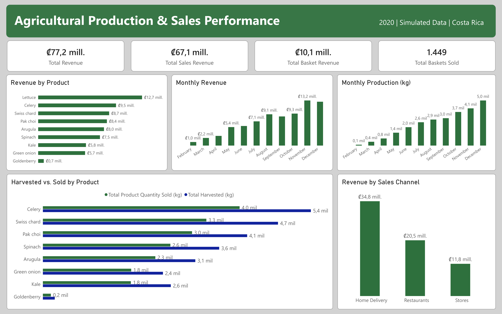

# Agricultural Production & Sales Analysis

Tools: Power BI

## Project Overview

This project analyzes agricultural production and sales performance throughout 2020 using simulated data inspired by a small agricultural business in Costa Rica.

The analysis was developed in Power BI to explore production volumes, sales revenue, product performance, and revenue distribution across sales channels.

The dataset was simulated and adapted to protect confidential business information while maintaining a realistic business context.

## Business Problem

Managing an agricultural business involves balancing production, sales, and revenue across different products and sales channels.

The objective of this project was to transform operational data into meaningful insights that could help answer questions such as:

- How much revenue was generated during the year?
- Which products contributed the most to total revenue?
- How did revenue change throughout the year?
- Which sales channels generated the most revenue?
- How did harvested quantities compare with quantities sold?

## Dataset

The project uses simulated datasets representing the main operational activities of an agricultural business during 2020.

The data includes:

- **Products:** Product information and measurement units.
- **Production:** Harvest records, quantities, and harvest dates.
- **Sales:** Product sales, quantities, prices, dates, and sales channels.
- **Basket Sales:** Weekly basket sales and associated revenue.
- **Basket Details:** Product composition of the weekly baskets.
- **Crop Information:** Crop areas and planting batch information.

All values were simulated or adapted for portfolio purposes and do not represent the actual financial or operational records of a business.

## Methodology

The project followed these main steps:

1. **Data Preparation:** Imported and prepared the datasets for analysis, including data type adjustments and date alignment.
2. **Data Modeling:** Established relationships between the tables to create an analytical data model.
3. **DAX Measures:** Developed measures to calculate total revenue, product sales revenue, basket revenue, harvested quantities, and sold quantities.
4. **Data Visualization:** Designed an interactive Power BI dashboard to present key performance indicators and production and sales trends.
5. **Validation:** Checked measure calculations and reconciled revenue totals to ensure consistency.

## Key Findings

- **Total Revenue:** Approximately ₡77.2 million during 2020.
- **Product Sales Revenue:** Approximately ₡67.1 million.
- **Basket Revenue:** Approximately ₡10.1 million.
- **Baskets Sold:** 1,449.
- **Sales Channel Performance:** Home Delivery was the largest product sales channel, followed by Restaurants and Stores.
- **Product Performance:** Revenue varied considerably across products, highlighting differences in their contribution to overall sales.

These findings provide an overview of the business's production and sales performance throughout the year.

## Skills Demonstrated

- Power BI
- DAX
- Data Modeling
- Data Cleaning and Preparation
- Data Analysis
- Data Visualization
- KPI Development
- Business Analysis
